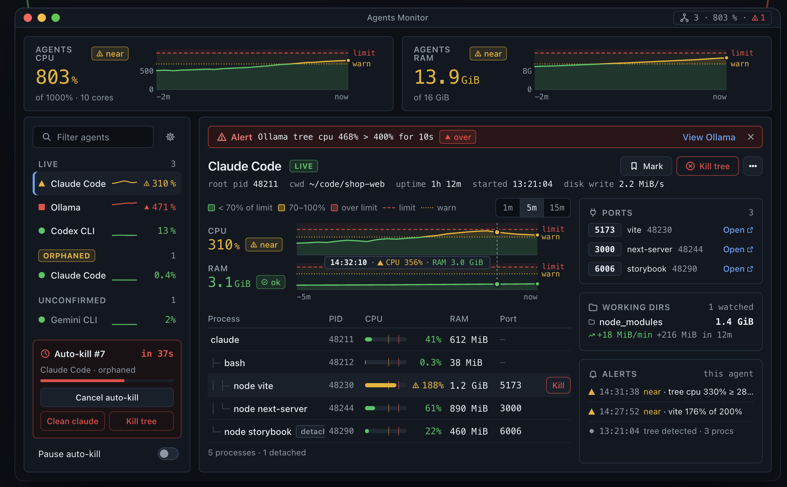
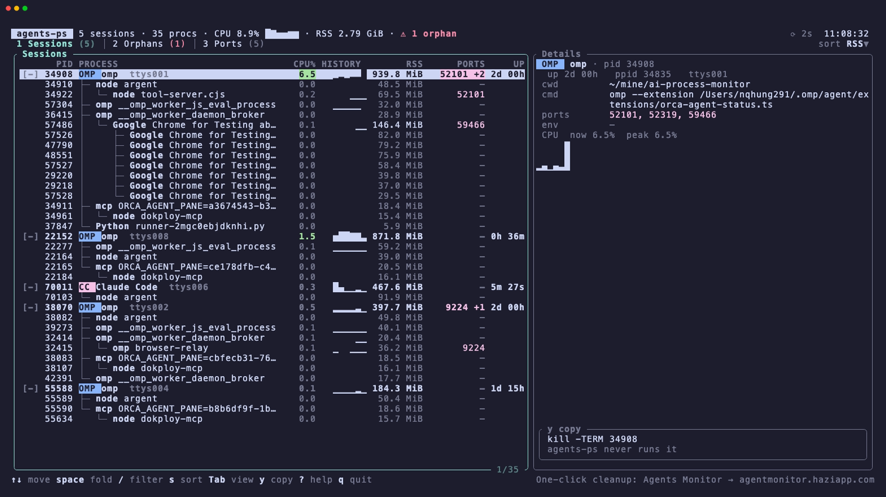

# agents-ps

<div align="center">

<h2>🖥️ Want a real app? <strong>Agents Monitor</strong> has a far better UI</h2>

A native macOS app that watches your agents continuously, so you never have to run a command.

<a href="https://agentmonitor.haziapp.com/?utm_source=agents-ps&utm_medium=readme&utm_campaign=banner"></a>

**[Get Agents Monitor → agentmonitor.haziapp.com](https://agentmonitor.haziapp.com/?utm_source=agents-ps&utm_medium=readme&utm_campaign=banner)**

</div>

What the app adds on top of `agents-ps`:

| | `agents-ps` (free CLI) | **Agents Monitor** (app) |
| --- | --- | --- |
| Agent sessions, process trees, ports | ✓ | ✓ |
| Orphans left behind by exited agents | ✓ one snapshot | ✓ remembered across sessions, plus unconfirmed suspects |
| Live CPU / RAM charts with warn and limit lines | — | ✓ 1m / 5m / 15m history per agent and per process |
| Threshold alerts and notifications | — | ✓ e.g. "Ollama tree CPU 468% > 400% for 10s", with an alert log per agent |
| Kill a process or a whole tree | — (prints `kill` for you) | ✓ one click, safe tree kill |
| Clean up orphans | — | ✓ one-click cleanup, or auto-kill with a countdown you can cancel or pause |
| Working-directory growth | — | ✓ watches dirs like `node_modules` (e.g. +18 MiB/min) |
| Open a dev server from its port | — | ✓ one click |
| Always on | — | ✓ menu-bar app, no command to run |

`agents-ps` answers one question about a Mac: what are my AI coding agents actually
running? It finds the process of every Claude Code, Codex CLI, Cursor Agent, Aider,
Gemini CLI, opencode, Goose, Amp, omp and Ollama session, groups everything that
session spawned into a single tree, and reports CPU, memory and listening TCP ports
per process. It also lists the processes those agents left behind after they exited,
and the ports they still hold. It reads the process table and prints; it never kills,
signals, writes or changes anything.

## Interactive view: `agents-ps top`

`agents-ps top` shows the same snapshot as a full-screen, keyboard-driven explorer:
agent sessions as live process trees on the left, the selected process on the right,
and Orphans and Ports views on `Tab`. It is read-only — there is no kill key; `y`
copies `kill -TERM <pid>` to the clipboard and leaves running it to you.



| Key | Action |
| --- | --- |
| `q`, `Ctrl-C` | quit |
| `Esc` | close help, clear filter |
| `Tab`, `Shift-Tab`, `1` `2` `3` | switch Sessions / Orphans / Ports |
| `j` `k`, `↑` `↓`, `g` `G`, `PgUp` `PgDn` | move |
| `Space`, `←` `h`, `→` `l`, `E` | fold, collapse, expand, toggle all |
| `/` | filter |
| `s` `S` | sort column: CPU, RSS, PID, AGE |
| `r` | reverse sort |
| `Enter` | details pane |
| `y` | copy `kill -TERM <pid>` to the clipboard (via `pbcopy`) |
| `R` | refresh now |
| `p` | pause |
| `+` `-` | refresh interval, 1–10 s (default 2 s) |
| `?` | help |

The screenshot is produced by [vhs](https://github.com/charmbracelet/vhs): run
`vhs docs/top.tape` from the repo root with `agents-ps` on your `PATH`.

```
$ agents-ps
agents-ps  4 sessions · 34 processes · 14.5% CPU · 1.98 GiB · sampled in 341 ms

omp  pid 34908 · ttys001 · up 1d 22h · 16 processes · 0.2% CPU · 772.6 MiB
  PID    PROCESS                                CPU        RSS  PORTS
  34908  omp orca-agent-status.ts              0.1%  168.1 MiB  52319
  34910    node argent                         0.0%   29.1 MiB  -
  34922      node tool-server.cjs              0.0%   60.2 MiB  52101
  34911    mcp ORCA_AGENT_PANE=a3674543-b3…    0.0%   18.4 MiB  -
  34961      node dokploy-mcp                  0.0%   15.4 MiB  -
  36415    omp __omp_worker_daemon_broker      0.0%   21.3 MiB  -
  57486      Google Chrome for Testing abo…    0.0%   99.2 MiB  59466
  22278        Google Chrome for Testing H…    0.0%   55.2 MiB  -
  25808        Google Chrome for Testing H…    0.0%   58.6 MiB  -
  29218        Google Chrome for Testing H…    0.0%   36.2 MiB  -
  29220        Google Chrome for Testing H…    0.0%   38.1 MiB  -
  57526        Google Chrome for Testing H…    0.0%   57.2 MiB  -
  57527        Google Chrome for Testing H…    0.0%   51.0 MiB  -
  57528        Google Chrome for Testing H…    0.0%   27.9 MiB  -
  37847    Python runner-2mgc0ebjdknhi.py      0.0%    5.9 MiB  -
  57304    omp __omp_worker_js_eval_process    0.1%   30.8 MiB  -
  total                                        0.2%  772.6 MiB  52101, 52319, 59466
```

Four sessions were running on the machine this was captured on; the other three are
elided. CPU is a percentage of one core measured over a 300 ms window, so a value
above 100% means more than one core.

The useful command is usually the second one:

```
$ agents-ps orphans
agents-ps orphans  1 process left behind by agents that already exited

  PID    PROCESS                         AGE          RSS  PORTS  LIKELY FROM  EVIDENCE
  15687  bash sleep 300 & bash -c "sle…  21h 30m  5.6 MiB  -      Claude Code  env marker

agents-ps never kills anything. To stop them yourself:
  kill -TERM 15687
```

```
$ agents-ps ports
agents-ps ports  5 listening ports owned by agent processes

  PORT   PID    PROCESS                       OWNER
  9224   32415  omp browser-relay             omp (session pid 38070)
  52101  34922  node tool-server.cjs          omp (session pid 34908)
  52319  34908  omp orca-agent-status.ts      omp (session pid 34908)
  53527  38070  omp orca-agent-status.ts      omp (session pid 38070)
  59466  57486  Google Chrome for Testing a…  omp (session pid 34908)
```

## Install

Homebrew:

```
brew install nqhung291/tap/agents-ps
```

On arm64 macOS 26 the formula pours a prebuilt bottle; everywhere else Homebrew
unpacks the release tarball. If Homebrew asks you to trust the tap first, run
`brew trust --formula nqhung291/tap/agents-ps`.

From source, with Rust 1.88 or newer:

```
cargo install --git https://github.com/nqhung291/agents-ps
```

Or download the release tarball for your Mac from
[Releases](https://github.com/nqhung291/agents-ps/releases), verify the `.sha256`
next to it, and put `agents-ps` on your `PATH`.

Requires macOS. There is no Linux or Windows build.

## Commands

| Command | What it prints |
| --- | --- |
| `agents-ps` | one block per agent session: agent, pid, uptime, its process tree with pid, short command, CPU, RSS, listening ports, and per-session totals. Sorted by total RSS, largest first. |
| `agents-ps orphans` | processes left behind by agents that already exited: pid, command, age, RSS, ports, the agent that likely spawned it, the evidence, and a copy-pasteable `kill -TERM` line. |
| `agents-ps ports` | listening TCP ports owned by agent trees or orphans, one row per port. |
| `agents-ps top` (alias `tui`) | interactive full-screen view of the same data: session trees, orphans and ports with folding, sorting, filtering and a details pane. Read-only. Needs a terminal; `--json` is not supported. |

Flags: `--json` for machine-readable output, `--no-hint` to drop the one line about
Agents Monitor (`top` accepts `--no-hint` too, to hide its footer hint), `--version`,
`--help`.

`--json` is versioned and stable: `schema` is `1`, pids are integers, sizes are bytes,
CPU percentages are floats (`cpu_pct`), and every list is deterministically ordered.
Session arrays are ordered largest RSS first, ports ascending.

Exit codes: `0` on success, `2` on a usage error.

Human output aligns columns, abbreviates sizes as KiB/MiB/GiB, and colours only when
stdout is a terminal with `NO_COLOR` unset.

## How detection works

**Session roots.** Each agent gets a rule that matches an executable basename
(`claude`, `codex`, `cursor-agent`, `aider`, `gemini`, `opencode`, `goose`, `amp`,
`omp`, `ollama`) or a substring of the argv (`@anthropic-ai/claude-code`,
`@openai/codex`, `@google/gemini-cli`, …). A matching process is a session root only
if none of its ancestors also matches, so `claude` launched from inside `omp` stays
inside omp's tree instead of becoming a second session.

**Trees.** From the root the tool walks children by ppid, depth-first, and stops at
the tree boundary. A pid that appears twice is visited once, and an ancestor cycle
terminates the walk.

**CPU.** macOS reports cumulative CPU time, so the tool takes two samples 300 ms
apart and reports the difference as a percentage of one core.

**Ports.** `libproc` reads each interesting pid's socket file descriptors and keeps
the TCP ones in `LISTEN`. No root, no `lsof`, no privileges.

**Orphans.** A process is a candidate when launchd has adopted it (`ppid == 1`, or
its parent is gone), it is not in any live agent tree, it is owned by you, and it is
not a macOS system binary. It is then attributed by the strongest evidence available:

1. `env marker` — an agent exports `CLAUDECODE=1`, `CLAUDE_CODE_*`, `CURSOR_TRACE_ID`,
   `CODEX_*`, `AIDER_*`, `GEMINI_CLI*`, `OPENCODE_*`, `GOOSE_*`, `OMP_*` or
   `OLLAMA_*`, and every child inherits it. The orphan is named after that agent.
2. `same project` — a dev runtime or port listener whose working directory is the
   working directory of a live session.
3. `heuristic` — a dev runtime or port listener re-parented to launchd with a working
   directory under your home. The agent is reported as unknown.

Nothing else is listed, which is why the output is short.

## Limitations

- **One snapshot, no memory.** `agents-ps` keeps no state between runs. An orphan is
  recognised from the evidence in its own process entry, so a leftover that carries
  no agent environment marker and does not run from your home directory is not
  reported. The desktop app remembers sessions across ticks and does not have this
  gap.
- **Name-based rules.** A renamed agent binary, or one whose argv mentions nothing
  recognisable, is missed.
- **300 ms CPU sample.** Short spikes are averaged out, and a process that just
  started can report `0.0%`.
- **TCP only.** UDP and Unix sockets are not listed, and only `LISTEN` sockets are
  reported — established connections are ignored.
- **Your own processes only.** Other users' processes are invisible; their
  environment and file descriptors are unreadable without root, and nothing here asks
  for it.
- **No background server.** Every invocation costs one sample interval (~0.4 s).

`agents-ps` never kills anything: there is no kill flag, no signal code, no
confirmation prompt. Where a cleanup would help, it prints the commands and you run
them.

## Want live monitoring?

[Agents Monitor](https://agentmonitor.haziapp.com/?utm_source=agents-ps) is the
native macOS app built on the same detection: continuous sampling, threshold alerts
and notifications, history across sessions, and one-click cleanup of what an agent
left running. `agents-ps` stays complete on its own and never needs it.

## License

MIT, copyright 2026 HaziApp. See [LICENSE](LICENSE).
